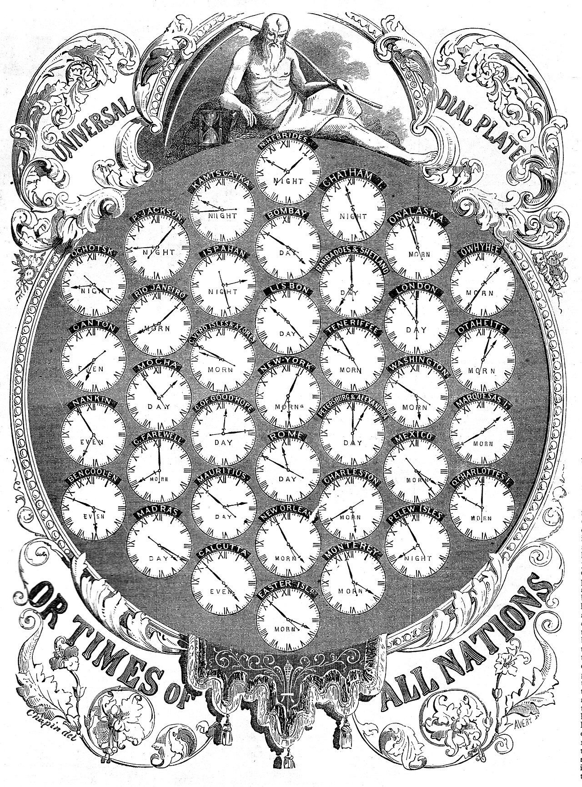

# Before standard time

<figure>

<figcaption>

An 1853 "Universal Dial Plate" showing the relative times of "all nations" before the adoption of universal time.[^source]

</figcaption>
</figure>

> Prior to the introduction of standard time, each municipality throughout the clock-using world set its official clock, if it had one, according to the local position of the Sun. This served adequately until the introduction of rail travel in Britain, which made it possible to travel fast enough over sufficiently long distances as to require continuous re-setting of timepieces as a train progressed in its daily run through several towns. Starting in 1847, Britain established Greenwich Mean Time (GMT), the mean solar time at Greenwich, England, to solve this problem: all clocks in Great Britain were set to this time regardless of local solar noon.[^wiki]

This raises the question of how to define a universal time:

- [UT1](https://en.wikipedia.org/wiki/Universal_Time), based on the rotation of the Earth with respect to distant stars
- [UTC](https://en.wikipedia.org/wiki/Coordinated_Universal_Time), based on cesium clocks

[^source]: _Gleason's Pictorial Drawing-Room Companion_ (bi-weekly), Vol. IV, No. 26 (Whole No. 104), June 25, 1853, p. 416. Boston: Frederick Gleason, Publisher. The Cooper Collections of U.S. History.
[^wiki]: From [Wikipedia](https://en.wikipedia.org/wiki/Universal_Time).
